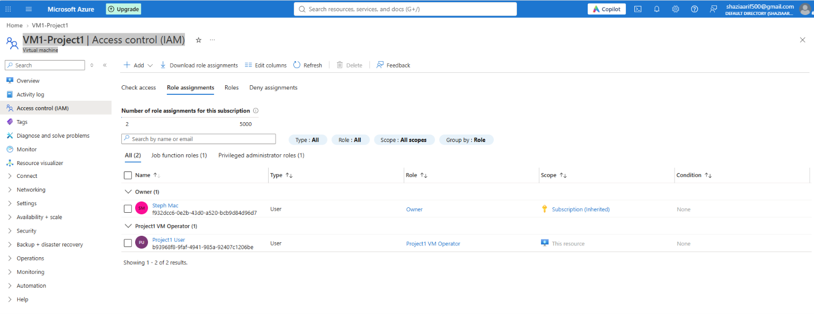
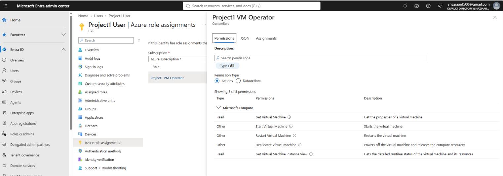
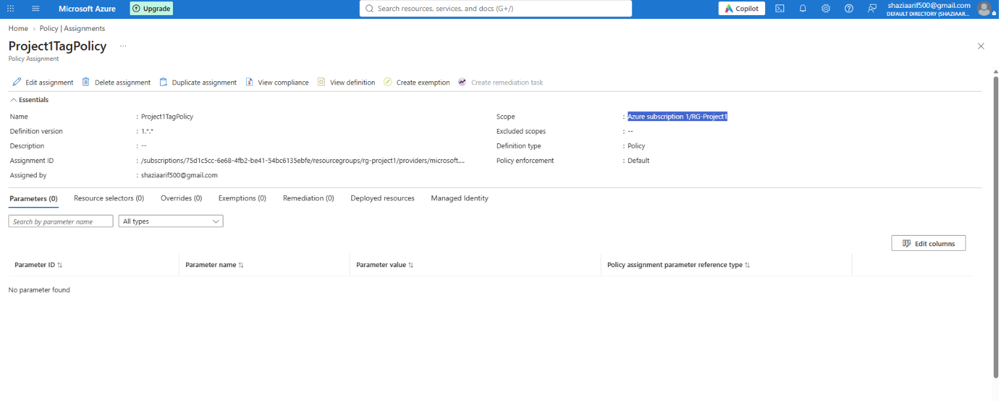
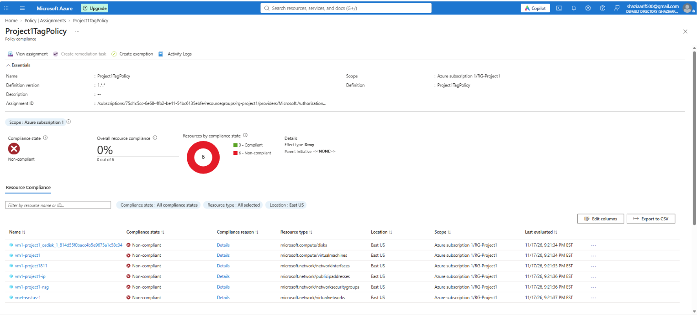
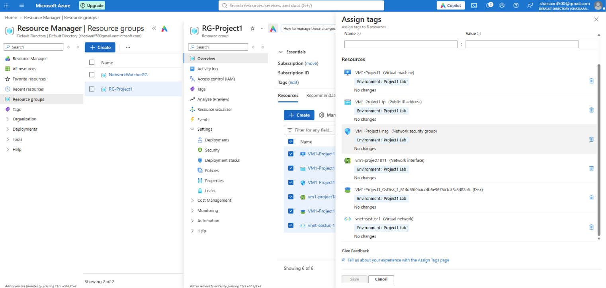
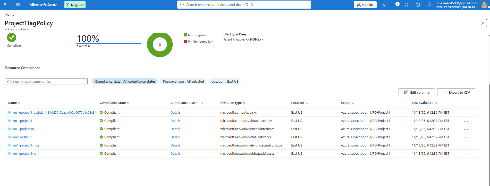
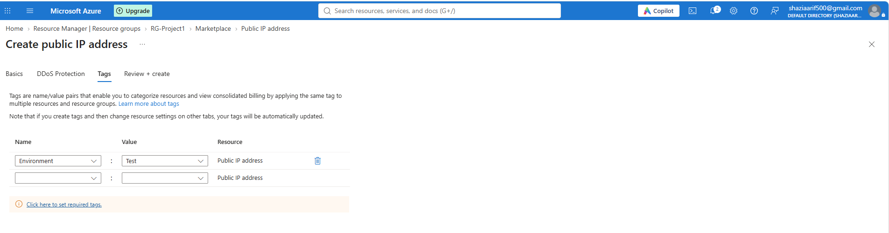

# 1) VM Creation

Created a 2019 DC VM, "VM1-Project1"

Size: Standard L2aos v4 (2 vcpus, 16 GiB memory)

In East US

In RG "RG-Project1"

(Screenshots may show a 2025 DC VM, with Size in D Series, that was changed as ADE Task ahead is Not Compatible with that setup)

# 2) Custom RBAC Role Assignment

Created a Test User in Entra, as "Project1User"

Created a Custom RBAC Role "Project1 VM Operator" at RG level (Custom Roles can only be made at Sub/RG Level)

At "VM1-Project1" Level, In IAM Blade, Added the Custom RBAC to VM Scope

Assigned to Test User "Project1User"

Tested User's Permissions/Access = Success

# 3) Azure Policy

Created an Azure Policy that Enforces a Tagging Requirement on All Resources inside the Scope that it's assigned to

Excluded VM Extensions as Tags cannot be added on them, Exclusions don't evaluate the Specified Resource at all

Marks Exisiting Resources as Non-Compliant until Required Tag is added on them, Non-Compliant Resources' Config cannot be changed until made Compliant

Denies New Resources being created without Required Tag

Tested Policy by Assigning to different scopes:

Added Required Tag to Existing Non-Compliant Resources, as well as attempted to create New Resource without Tag = Policy Succeeded

(Policy applied at a Scope includes that Scope itself as an Evaluated Resource in Compliance List, like a Sub Scope)

(Though RGs are Blocked from Compliance List, Regardless of Scope and PolicyMode being Indexed/All)

(Excluded Resources are also Blocked from Compliance List, as they are not Evaluated At All)

# 4) Azure Disk Encryption (ADE)

Created a Key Vault to store ADE Key (KEK) in

