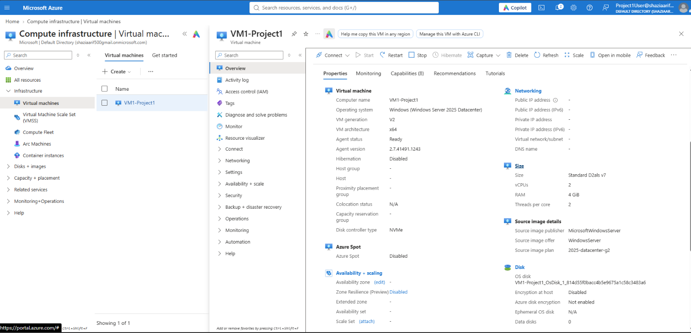

# 1) VM Creation
Created a 2019 DC VM, "VM1-Project1"

Size: Standard L2aos v4 (2 vcpus, 16 GiB memory)

In East US

# 2) Custom RBAC Role Assignment

Created a Test User in Entra, as "Project1User"

Created a Custom RBAC Role "Project1 VM Operator" at RG level

Added the Custom RBAC to "VM1-Project1" Scope

Assigned to Test User "Project1User"

